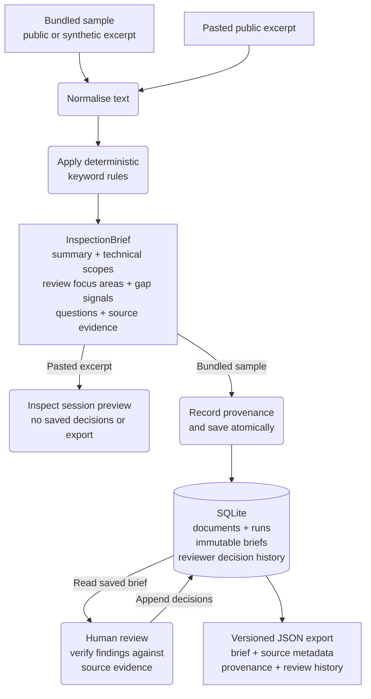

# Tender-to-Inspection Brief

Technical review briefs from public construction tender excerpts.

The application uses deterministic keyword rules to identify technical scopes, flag information gaps, and suggest follow-up questions. Reviewers inspect the supporting source snippets, record decisions on saved findings, and download the brief with its processing and review history.

[Open the application](https://tender-inspection.streamlit.app)

## Review workflow

1. Choose a bundled public or synthetic sample in **Review workspace**, or open **Analyse a public excerpt** to paste public, non-confidential text.
2. Scan the overview, then inspect one finding at a time with its supporting source text before recording a decision.
3. For bundled samples, save **Accepted**, **Rejected**, or **Needs follow-up** decisions with optional notes, then download the brief as JSON.

Open **How it works** in the application for a short walkthrough. See the [user guide](docs/user-guide.md) for the workspace tabs, review filters, session previews, and downloads.

## How it works

The Streamlit interface and command-line pipeline use the same text cleaning, keyword rules and brief models. Bundled results are saved in SQLite and reused on later visits. Pasted excerpts produce a temporary preview for the current browser session.



Rounded boxes denote actions, square-cornered boxes denote inputs or outputs, and the cylinder denotes persistent storage. JSON export is available before or after reviewer decisions are saved.

- Each persisted brief links to a processing run with extractor and schema versions and a SHA-256 fingerprint of the normalised source.
- Reviewer decisions append history events without changing the generated brief.
- Explicit reprocessing appends a new run and brief; earlier decisions remain attached to the earlier brief.
- Failed sample processing preserves previously saved data.
- The displayed review and JSON export are built from the same SQLite read snapshot.

See [architecture and data contracts](docs/architecture.md) for processing steps and exact guarantees, and the [decision log](docs/decision_log.md) for rationale and trade-offs.

## Run locally

Use Python 3.11–3.13, the versions covered by CI. On macOS or Linux:

```bash
git clone https://github.com/NikolayAir/tender-inspection-pipeline.git
cd tender-inspection-pipeline
python3 -m venv .venv
source .venv/bin/activate
python -m pip install -r requirements.txt
python -m streamlit run src/app/streamlit_app.py
```

Open the local URL printed by Streamlit. The application initialises the bundled samples in `data/processed/tender_inspection.db` and retains completed results and their reviewer decisions on later starts. After dependency installation, the bundled workflow runs without network access or API keys.

For pipeline commands, Windows setup, and local checks, see [development](docs/development.md).

## Scope and validation

The current extractor matches declared keywords; it does not interpret context. French coverage is limited to terms used in the bundled Luxembourg examples. Evidence locations are approximate source references.

The validation set contains one synthetic sample and two curated public excerpts. It supports qualitative review and regression checks, with no statistical accuracy claim. See [data and validation](docs/data-and-validation.md) for sources, expectations, and known gaps.

PDF ingestion, URL fetching, authentication, reviewer identity, and simultaneous review editing are not implemented. Processing history is retained, but complete historical source-text revisions are not.

The output supports human technical review. It does not make legal, regulatory, compliance, safety, or engineering decisions.

## Documentation

| Document | Contents |
| --- | --- |
| [User guide](docs/user-guide.md) | Reviewing samples, pasted excerpts, decisions, and downloads |
| [Architecture and data contracts](docs/architecture.md) | Processing, persistence, recovery, provenance, and export compatibility |
| [Data and validation](docs/data-and-validation.md) | Sample sources, qualitative validation, and extraction limits |
| [Development](docs/development.md) | Environment setup, pipeline commands, local checks, and CI |
| [Product brief](docs/product_brief.md) | Intended users, product boundaries, and direction |
| [Decision log](docs/decision_log.md) | Product and technical decisions with their trade-offs |

Versioned release notes are available in [GitHub Releases](https://github.com/NikolayAir/tender-inspection-pipeline/releases).

## Security

Report suspected vulnerabilities through GitHub Private Vulnerability Reporting as described in [SECURITY.md](SECURITY.md).

## License

Original source code and documentation are available under the [MIT License](LICENSE). Curated public procurement excerpts in `data/samples/` retain their recorded source attribution and are outside that license.
