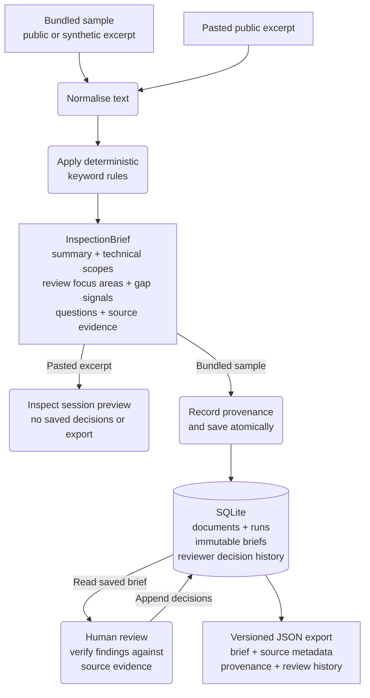

# Architecture and data contracts

[Project overview](../README.md) · [User guide](user-guide.md) · [Development](development.md) · [Decision log](decision_log.md)

The Streamlit interface and command-line pipeline share Python extraction and Pydantic models. SQLite stores bundled documents, processing history, generated briefs, and reviewer decisions. The bundled workflow has no runtime dependency on an external API, model provider, or network service.

## Processing paths

The [compact overview in the README](../README.md#how-it-works) summarises the two workflows. This diagram expands the shared processing path and the stored records used for review and export.

Rounded boxes denote actions, square-cornered boxes denote inputs or outputs, and the cylinder denotes persistent storage. The atomic save covers one bundled sample; reviewer decisions are appended separately. JSON export is available before or after decisions are saved.

The bundled path is coordinated by [`src/pipeline.py`](../src/pipeline.py):

1. [`sample_loader.py`](../src/collect/sample_loader.py) reads a UTF-8 sample, parses source metadata from comment headers, and constructs a `TenderDocument`. Comment lines are excluded from the document text; `SOURCE` and `SOURCE_URL` are mapped to model fields, while other reference metadata stays in the sample file.
2. [`clean.py`](../src/parse/clean.py) normalises Unicode to NFC and line endings to `\n`, trims trailing whitespace on each line, and removes outer whitespace.
3. [`risk_extract.py`](../src/ai/risk_extract.py) extracts an `InspectionBrief` from the normalised text before a write transaction is opened.
4. Inside the transaction, the pipeline finds or creates the logical document and prepares provenance through [`provenance.py`](../src/provenance.py).
5. [`database.py`](../src/db/database.py) saves the document changes, processing run, and linked brief together.
6. [`streamlit_app.py`](../src/app/streamlit_app.py) reads the saved review, displays findings, accepts separate reviewer decisions, and prepares the JSON download.

The pasted-text path constructs an in-memory document and reuses normalisation, extraction, and rendering. It does not persist the excerpt or create downloadable exports.

## Extraction contract

The extractor scans text case-insensitively for declared keyword substrings and maps them to technical domains. It returns a neutral summary, technical scopes, possible review focus areas, information gaps, suggested questions, and evidence. All current extraction results set `confidence` to `low` and `human_review_required` to `true`.

Each detected domain has one evidence snippet. The extractor selects the first matching keyword in taxonomy order, then uses a non-title line containing that keyword when available. Otherwise it uses the title. Locations are approximate, one-based lines in the normalised document, not page, section, paragraph, or drawing references.

Information-gap detection matches declared English phrases after flattening whitespace. For each phrase, it records the first matching sentence that has not already been reported. Its evidence is labelled `source text` rather than assigned a line number. When neither a domain nor an information gap is detected, the brief includes a manual-review message.

Rules do not interpret context, and the taxonomy has limited French construction terminology. [Data and validation](data-and-validation.md) describes the examples and known gaps. Shared model definitions are in [`src/models.py`](../src/models.py).

## Persisted records

| Record | Responsibility | History boundary |
| --- | --- | --- |
| `documents` | Current source record for a logical document | Complete source-text revisions are not preserved |
| `processing_runs` | Timestamp, extractor and schema versions, and source fingerprint for one run | A new record is stored for each persisted run |
| `briefs` | Generated result linked to one exact processing run | Generated briefs remain immutable |
| `reviewer_decisions` | Human-authored state and optional note for one generated target | Each successful save appends an event |

A logical document is identified by `(source, title)`. Explicit processing reuses that document, updates its current source record, and appends a processing run and brief. Earlier briefs and their decisions remain stored; the interface displays the latest brief.

Each processing run records a UTC timestamp, extractor name and version, brief-schema version, and SHA-256 fingerprint of the normalised source text. The fingerprint identifies the processed text but does not preserve earlier source revisions.

Reviewer targets are identified by `brief_id`, `target_type`, and a zero-based `target_index`. Supported target types are `risk_domain` and `missing_info`. States are `accepted`, `rejected`, and `needs_follow_up`. An item with no event is displayed as `Unreviewed` without a stored record. Generated review questions are not decision targets. New briefs start without decisions; earlier decisions are not transferred.

Supported database migrations preserve stored data. Historical briefs without recorded provenance receive explicit legacy metadata rather than inferred current-version values.

## Write transactions

Each sample-processing attempt saves document changes, the processing run, and its brief through one connection and transaction. Failure during extraction, provenance preparation, or persistence preserves the previous source text and metadata, processing history, reviewer decisions, and serialised export.

Atomicity applies per sample: an earlier successful sample remains saved if processing a later one fails. Schema initialisation and supported migrations are separate from processing transactions.

## Recovery and consistent reads

### Automatic sample recovery

Automatic initialisation checks each bundled sample by `(source, title)`. A sample is complete when its stored document has a brief linked to a processing run for that same document, including restored legacy provenance. Unrelated documents do not count towards completeness.

Completed samples are retained even if the bundled source file or extractor version has changed. Once all samples are complete, repeated initialisation adds no records. Refreshing a completed result requires explicit pipeline execution.

Extractor `1.0.1` corrects the generated summary for excerpts with no keyword or information-gap phrase matches. The manual-review notice is excluded from its information-gap count but remains a `missing_info` review target at its original index. Matching rules and the brief and export schemas are unchanged. Earlier briefs retain their original summaries and provenance; the correction applies to newly generated briefs.

Recovery checks completeness before extraction and again inside the write transaction. If another session has completed the sample in the meantime, the later attempt skips the write. Extraction can therefore complete without storing a redundant result. Standalone completeness lookups use read connections without reserving write access.

If recovery fails, the interface keeps readable saved documents, reviews, and downloads available, shows a recovery warning, and retries on refresh. A successful retry retains the selected document. An empty database, unavailable storage, and an unreadable selected review receive separate messages.

The interface reports invalid saved data when JSON cannot be decoded or parsed, a processing or decision timestamp cannot be read, or saved values fail model validation. Timestamp parsing failures are classified at the storage boundary, so the interface can explain invalid saved data without hiding unrelated programming errors. The interface logs the cause and keeps other documents selectable. The failed read does not repair, replace or delete saved records; completed results remain outside automatic reprocessing.

### Consistent review reads

The interface reads the selected document, its latest brief, processing metadata, and reviewer-decision history in one SQLite read transaction. The source excerpt, findings, reviewer controls, and JSON download therefore use the same saved result, even if an explicit pipeline run saves a newer result while the page is loading. Standalone exports also read the result and decisions in one transaction.

The read transaction ends before rendering. A page may finish with the earlier result if reprocessing completes after its snapshot begins; the next full page rerun reads the latest result. The JSON preview and download actions retain that captured payload and serialised JSON in a Streamlit fragment. Opening the viewer does not read storage again or rerun the decision form; the viewer's download uses the same JSON. A form submitted for an earlier brief is not applied to a newer brief. These guarantees do not provide reviewer identity, authentication, or simultaneous review editing.

Review controls use a separate fragment, so editing fields or moving between findings retains the displayed snapshot. Draft choices and notes are kept in the session under the original brief, target type and target index. Only the save button queues a submission. A full rerun reads the current brief before writing; a request for an earlier brief is rejected. After a successful write, another consistent read supplies the updated review and export. If that read fails, the interface reports that the decision was saved while explaining that the review is unavailable.

Switching to pasted excerpts retains the selected document, workspace tab, filter, finding and source-snippet selection in session state. Returning restores those controls without saving a decision. Filter and finding keys retain the original brief identifier, so a newly processed brief starts with its own queue and drafts. Restored controls are checked against the available documents and findings; this navigation context lasts only for the current browser session.

## Versioned JSON export

[`src/exports.py`](../src/exports.py) defines the export models and deterministic serialisation. The interface downloads current schema `1.1.0`. Schema `1.0.0` remains available for explicit compatibility serialisation without reviewer-decision history.

| Field | Contents |
| --- | --- |
| `export_schema_version` | Export envelope version |
| `document` | Stored document ID, source label, source URL, and title |
| `processing_run` | Linked run ID, UTC timestamp, extractor and brief-schema versions, and normalised-source fingerprint |
| `brief_id` | Persisted generated-brief ID |
| `brief` | Complete generated brief, including source evidence |
| `reviewer_decisions` | Schema `1.1.0` only: complete history ordered by strictly increasing event ID |

Each reviewer event contains its ID, target type and index, state, optional note, and UTC decision timestamp. Export-schema, brief-schema, and extractor versions are independent compatibility boundaries.

Serialisation uses sorted keys, two-space indentation, UTF-8-compatible text, and one terminating newline. Serialising the same persisted payload repeatedly produces identical bytes.

Independent runs retain different database identifiers and processing timestamps. The [reproducibility test](../tests/test_reproducibility.py) excludes only `document.id`, `processing_run.id`, `processing_run.processed_at`, and `brief_id`, then deeply compares the remaining stable payload, including evidence ordering. This does not claim byte-identical exports across runs or statistical extraction accuracy.

An export represents one persisted brief and its linked records. It is not a database dump, source-document archive, or complete source-revision history.
