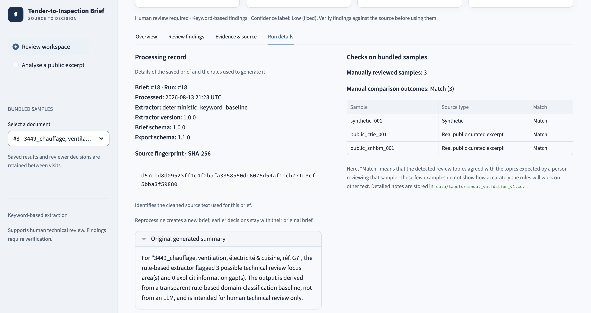

# Data and validation

[Project overview](../README.md) · [User guide](user-guide.md) · [Extraction contract](architecture.md#extraction-contract)

## Bundled samples

Three committed samples under [`data/samples/`](../data/samples/) can be processed without network access.

| Sample | Type | Coverage |
| --- | --- | --- |
| [`synthetic_sample_tender_001.txt`](../data/samples/synthetic_sample_tender_001.txt) | Synthetic fixture | Offline keyword and information-gap testing; not a real tender |
| [`public_lu_pmp_ctie_001.txt`](../data/samples/public_lu_pmp_ctie_001.txt) | Curated public excerpt | Luxembourg public notice 217578-2026, PMP reference 2600237; asbestos remediation and selective deconstruction |
| [`public_lu_pmp_snhbm_belvaux_001.txt`](../data/samples/public_lu_pmp_snhbm_belvaux_001.txt) | Curated public excerpt | Luxembourg PMP reference 2601359; heating, ventilation, electrical, and kitchen works |

The public samples are short, manually curated excerpts from Luxembourg procurement consultations. No scraping was performed, and no full tender dossier was committed. Official source URLs, reference metadata, retrieval dates, and reuse notes are recorded in the sample headers.

The repository's MIT License covers original code and documentation. The curated public procurement excerpts retain their recorded source attribution and are outside that license.

## Qualitative validation

[`data/labels/manual_validation_v1.csv`](../data/labels/manual_validation_v1.csv) records manually expected domains, extractor output at validation time, match status, notes on taxonomy gaps, and known limitations for each sample.

All three samples currently match their declared expected domains:

| Sample ID | Declared expected domains |
| --- | --- |
| `synthetic_001` | Fire safety; Electrical; HVAC; Facade; Road / Infrastructure; Asbestos / hazardous materials; Water / Sewer |
| `public_ctie_001` | Asbestos / hazardous materials; Structure / deconstruction; Remediation / site preparation; Materials reuse / circularity |
| `public_snhbm_001` | HVAC; Electrical; Kitchen / catering installations |

A `match` means agreement with the declared expectations for that sample. It does not establish exhaustive identification of the tender's technical scope.

The [validation regression test](../tests/test_validation.py) reruns extraction and compares the detected domain set with the CSV's recorded `extracted_domains`. It guards against changes in the baseline output; it does not evaluate precision or recall against an independent gold standard. Intentional extraction changes require reviewing the recorded output and notes.

The interface's validation snapshot reads the committed CSV for display. It does not run a new evaluation of the selected document or pasted text.

## Interpretation limits

The validation set is too small to support precision, recall, F1, or broad language-coverage claims. The synthetic fixture was written to exercise keyword coverage, and French terms were added for the curated public examples. These examples are not an independent performance evaluation.

| Area | Current limitation |
| --- | --- |
| Context | Keyword substrings can match without the intended technical meaning; paraphrases and domains outside the taxonomy can be missed |
| French coverage | A small targeted terminology extension; information-gap detection uses English phrases only |
| Evidence | Approximate normalised-text line references, or `source text` for information-gap signals; no page, section, paragraph, or drawing references |
| Dataset | One synthetic fixture and two short public excerpts; no full-dossier evaluation |
| Pasted excerpts | Outside the committed validation set |

Known taxonomy gaps recorded in the CSV include structural drawings and energy performance in the synthetic sample, and hazardous-waste disposal, site logistics, and works around the retained buried section in the CTIE excerpt. A sample can match its declared expected domains while still containing these unrepresented topics.

Generated briefs always require human review. The application does not provide regulatory assessment, document management, BIM coordination, site-inspection records, or defect tracking. Product boundaries and direction are described in the [product brief](product_brief.md).
