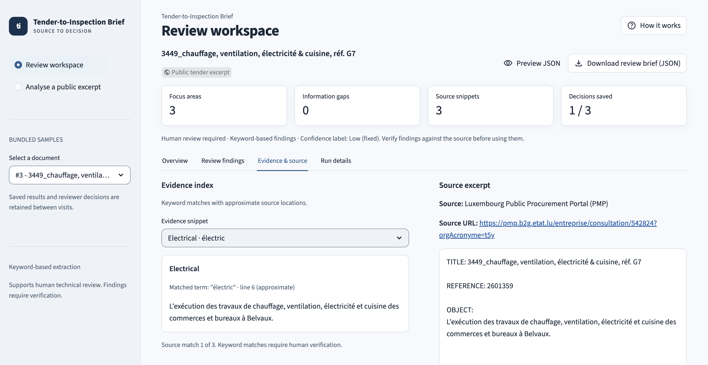
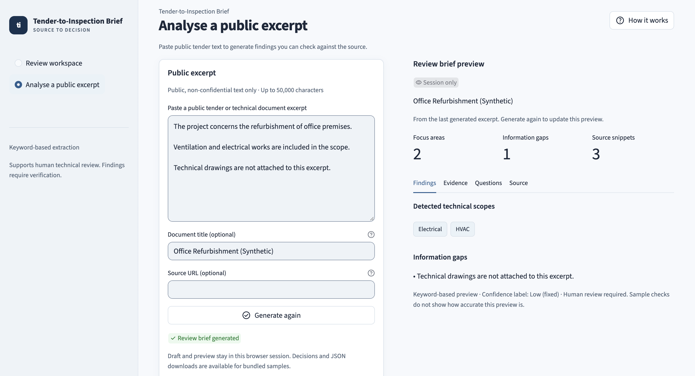
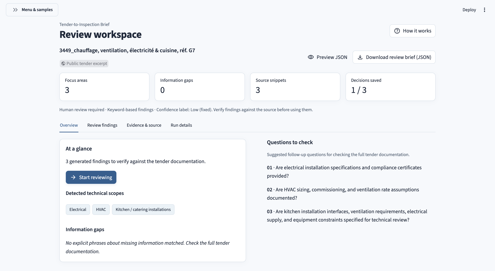
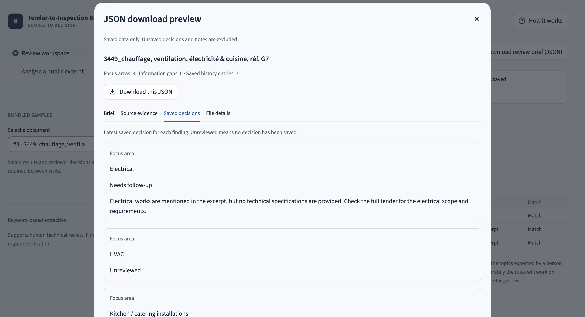

# User guide

[Project overview](../README.md) · [Architecture and data contracts](architecture.md) · [Data and validation](data-and-validation.md)

Tender-to-Inspection Brief provides two review paths:

| Path | Input | Saved results | Reviewer decisions | JSON download |
| --- | --- | --- | --- | --- |
| **Review workspace** | Three bundled public or synthetic excerpts | SQLite | Supported | Supported |
| **Analyse a public excerpt** | Pasted public, non-confidential text | Session-only preview | Unavailable | Unavailable |

## Review a bundled sample

1. Open **Review workspace** and select a document under **Bundled samples** in the sidebar. The document badge distinguishes public excerpts from synthetic test data.
2. Scan **Overview** for technical scopes, information gaps, and suggested questions. The header shows the number of findings, source snippets, and saved decisions. **Start reviewing** sits below the short finding count in **At a glance**.
3. Select **Start reviewing**, or open **Review findings**. Choose one finding, check its supporting source text, and use the decision form to record your review. Use **Previous**, **Next**, or the finding selector to move through the brief; **Review status** filters the queue.
4. Use **Evidence & source** to read complete matching snippets beside the original excerpt and its source attribution. **Run details** contains processing versions, the source fingerprint, and **Checks on bundled samples**. Expand **Original generated summary** to read the exact saved text.
5. Open **Preview JSON** to inspect the saved result and decision history, then use **Download review brief (JSON)** to keep the file.

When the available workspace is narrow, including a tablet or small desktop window with the sidebar open, the app uses a compact metric grid, stacks related panels and places the JSON actions below the document title. The two actions align to the right and wrap when needed. Wider workspaces show the source and decision panels side by side.

The sidebar starts open on a wide screen and collapsed on a narrow screen. When hidden, use **Menu & samples** at the top left to change workflows or samples; the control has a visible label as well as an arrow. The full application name remains visible above the workspace heading.

Suggested questions are prompts for the reviewer, not conclusions about the tender. A keyword match identifies a possible review topic; the reviewer determines what needs follow-up. **Low** is a fixed confidence label and not an accuracy score. Every generated brief requires human review.

### Record decisions

For each generated focus area or information gap, select **Accepted**, **Rejected**, or **Needs follow-up**, optionally add a note, and save. Notes are limited to 2,000 characters. Items without a saved decision appear as **Unreviewed**; displaying that state does not create a database record.

**Save decision** records the selected decision and optional note for the current finding. After editing a saved decision, **Save changes** uses the primary button style and shows **Unsaved changes**. A successful save shows a check mark, **Decision saved** and a secondary **Save again** button. The saved or unsaved indicator updates when you finish editing a field; editing alone does not write to the saved history or JSON.

Unsubmitted choices and notes stay with their finding and brief during navigation in the same browser session. Reloading the browser clears these drafts. If a database error prevents saving, the choice and note remain in the form. Select **Retry save** without refreshing the page. When a save changes an item's status, a filtered queue may advance to another matching finding. The confirmation appears once, and the saved-decision count updates. An empty filter means no findings match that status; change the filter to continue. **Decisions saved** counts findings with a recorded decision, including those still marked **Needs follow-up**.

Each save appends an event, including **Save again** when the fields are unchanged. The latest event determines the displayed state, and earlier states and notes remain in the history. Saving a decision does not alter the generated brief. Generated questions are not separate decision targets.

Decisions belong to the specific brief being reviewed. If an explicit pipeline run creates a new brief, earlier decisions remain attached to the earlier brief and are not copied to the new one. A form submitted for an earlier brief is not applied to a newer brief.

## Preview a public excerpt

1. Open **Analyse a public excerpt** from the sidebar.
2. Paste non-empty public, non-confidential text, up to 50,000 characters. A document title and source URL are optional; the URL is reference metadata and is not fetched. The first non-empty `TITLE:` line in the text takes precedence over the optional title field. Blank title lines are ignored; without either title, the preview uses **Pasted public excerpt**.
3. Select **Generate review brief**. Inspect the result using **Findings**, **Evidence**, **Questions**, and **Source**. The preview appears beside the input when there is room, or below it in a compact workspace.

After generation, a check mark and **Review brief generated** confirm that the preview matches the input. **Generate again** lets you repeat the action. When the excerpt, title or source URL differs from the input used for the preview, the button changes to **Update review brief**.

The current draft and last generated preview remain available when opening help or switching workflows in the same session, including edits that have not yet been analysed. Editing a field keeps the draft without running extraction. **Update review brief** updates the result; until then, a changed-input notice identifies the previous preview. If a new submission is invalid, that preview remains clearly labelled. Reloading the browser starts a new session and clears the draft and preview.

This path uses the same text cleaning and extraction as the bundled workflow. Pasted content is processed only in the current session; it is not written to SQLite or exported. The application does not scrape websites, parse PDFs, or call an external model or API.

When no configured keywords or gap phrases match, the preview shows a manual-review notice. This notice is not counted as an information gap. Zero matches do not establish completeness; read the excerpt manually.

The bundled validation results do not establish extraction quality for pasted text. See [data and validation](data-and-validation.md) for the tested examples and limitations.

## In-app help and navigation

**How it works** opens a guide over the current workspace. **Quick start** walks through a bundled review, **Pasted excerpts** explains the temporary preview, **How findings are generated** describes the keyword rules and their limits, and **Command line** shows local processing commands. Close the dialog or press Escape to return.

The sidebar labels the method **Keyword-based extraction**. The guide explains that a hosted application processes pasted text on its server, while the preview is not written to the app's database. The rules do not use a large language model or call an external AI service to generate findings.

**Start reviewing** brings the review controls into view. A successful pasted analysis reveals the preview when it is outside the useful viewport, including below the input on a narrow screen. Saving a decision, submitting invalid input, and ordinary reruns retain the current position. The reveal respects reduced-motion preferences.

When the sidebar is hidden, **Menu & samples** remains visible in the header. It opens both workflow navigation and the document selector, including on a narrow screen.

## Saved results and recovery

The application automatically processes bundled samples whose stored results are missing or incomplete. Completed results and their decisions are retained, including when the bundled source file or extractor version has changed. Restarting or refreshing the application does not explicitly reprocess completed samples.

To refresh completed results, use the [pipeline commands](development.md#pipeline-commands). An explicit run appends new processing runs and briefs. A failed attempt preserves the previously saved source, results, and decisions.

If automatic recovery fails, readable saved reviews and JSON downloads remain available with a recovery warning. Refresh to retry. Unavailable storage or an unreadable selected review receives a separate error message. See [recovery and consistent reads](architecture.md#recovery-and-consistent-reads) for the exact guarantees.

If a saved review contains invalid data, the app asks you to choose another document. Other readable reviews remain available. The invalid review and its decision history are retained; the app does not automatically replace the result.

If the app confirms a saved decision and then reports that the review could not be loaded, the save has completed. The read error does not undo that decision.

## JSON download

The download contains the selected persisted brief, its linked processing run, source metadata and evidence, and the complete ordered reviewer-decision history. It uses export schema `1.1.0`.

**Preview JSON** opens a read-only window with **Brief**, **Source evidence**, **Saved decisions**, and **File details**. It shows the latest saved decision for each finding and the complete history separately. **Exact JSON** reveals the file contents with long lines wrapped for reading. **Download this JSON** saves the result shown in that window.

The preview and its download use the same saved result captured for the displayed workspace. Opening or closing the window does not submit a decision or discard an unfinished note. Unsaved form changes are excluded. This viewer is available for bundled saved briefs; pasted excerpts retain their separate session-only preview.

The source excerpt, displayed findings, reviewer controls, and download use the same saved result for that page load. Downloading does not rerun the page or submit the decision form. If reprocessing finishes after the page reads its data, the next full page rerun shows the newer result.

The export represents one brief and its linked records. It does not contain the full source text or a complete document-revision archive. See the [export contract](architecture.md#versioned-json-export) for compatibility and serialisation details.
